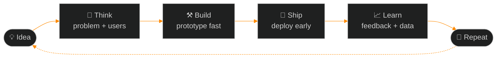

<!-- ═══════════════════════════════════════════════════════════════
     Vinod Patel · GitHub profile README  (black + orange "ignition" theme)
     Repo name must be exactly: Vinod1234-JPG  (public)
     Put the banner at: assets/banner.png
     ═══════════════════════════════════════════════════════════════ -->

<div align="center">


<a href="https://github.com/Vinod1234-JPG">
  
</a>

<br/>

<!-- Command bar: click to jump -->
<a href="#system-profile"></a>
<a href="#choose-your-path"></a>
<a href="#tech-stack"></a>
<a href="#how-i-build"></a>
<a href="#the-lab"></a>
<a href="#lets-connect"></a>

<br/><br/>


</div>

<br/>

## System Profile

```ts
// vinod.config.ts
export const vinod = {
  name:       "Vinod Patel",
  handle:     "Vinod1234-JPG",
  roles:      ["Full Stack Developer", "Chief Product Officer (CPO)"],
  education:  "B.E. Computer Science & Business Systems — MITM, Mysore",
  stack:      ["React", "Next.js", "TypeScript", "Node.js", "Python", "C++", "Flutter"],
  also:       ["IoT & Embedded", "Data Automation", "PDF Reports", "Three.js"],
  philosophy: "I don't just write code. I build systems.",
  loop:       ["Think", "Build", "Innovate", "Repeat"],
  status:     "🟠 online — open to collaborations, internships & big ideas",
} as const;
```

<br/>

## Choose Your Path

> *Click a card to expand it.*

<details>
<summary><b>🟠 &nbsp;I'm hiring</b></summary>
<br/>

- 🌐 See the work → **[Portfolio](https://profile-5yeo.vercel.app/)**
- 💼 Let's talk → **[LinkedIn](https://www.linkedin.com/in/vinod-patel-aab6a53a6)**
- 🧩 Full stack on web and mobile, plus product thinking from the CPO seat

</details>

<details>
<summary><b>🟠 &nbsp;I want to build something together</b></summary>
<br/>

I'm up for:
- 🚀 Product ideas that need both an engineer and a product mind
- 📡 IoT / embedded prototypes
- 🎮 Browser games & 3D experiences
- 🤖 Automation tools for Excel, PDFs and data workflows

Open an issue on any repo or message me on LinkedIn.

</details>

<details>
<summary><b>🟠 &nbsp;Just exploring</b></summary>
<br/>

Welcome in. Scroll on for the stack, the process and live stats. If something here helps you, leave a ⭐.

</details>

<br/>

## What Drives Me

<table>
<tr>
<td width="33%" align="center">
<h2>&lt;/&gt;</h2>
<b>Build Scalable Apps</b><br/>
<sub>Clean architecture, fast interfaces, systems that keep working as they grow.</sub>
</td>
<td width="33%" align="center">
<h2>💡</h2>
<b>Innovate with Ideas</b><br/>
<sub>Start from the user's problem, then pick the tech that solves it.</sub>
</td>
<td width="33%" align="center">
<h2>🚀</h2>
<b>Turn Ideas into Reality</b><br/>
<sub>Prototype fast, ship early, and improve with real feedback.</sub>
</td>
</tr>
</table>

<br/>

## Tech Stack

<div align="center">

| Layer | Tools |
|:--|:--|
| **Frontend** |  |
| **Backend** |  |
| **Mobile** |  |
| **Systems** |  |
| **3D & Creative** |  |
| **Workflow** |  |

</div>

<div align="center">


</div>

<br/>

## How I Build



<br/>

## The Lab

<details>
<summary><b>📡 &nbsp;IoT & Embedded Systems</b></summary>
<br/>

Sensor-driven and microcontroller-based projects where software meets the physical world.

</details>

<details>
<summary><b>📄 &nbsp;PDF Report Generation</b></summary>
<br/>

Python + ReportLab pipelines that turn raw data into clean, styled, ready-to-share reports.

</details>

<details>
<summary><b>📊 &nbsp;Data Automation</b></summary>
<br/>

Excel workflows with openpyxl, plus extracting structured data from images. Manual work in, one-click scripts out.

</details>

<details>
<summary><b>🎮 &nbsp;3D Web & Games</b></summary>
<br/>

Browser-based 3D worlds and games built with Three.js.

</details>

<br/>

## Live Stats

<div align="center">


<br/>


<br/><br/>


</div>

<br/>

## Contribution Snake

<div align="center">

<picture>
  <source media="(prefers-color-scheme: dark)" srcset="https://raw.githubusercontent.com/Vinod1234-JPG/Vinod1234-JPG/output/github-snake-dark.svg" />
  <source media="(prefers-color-scheme: light)" srcset="https://raw.githubusercontent.com/Vinod1234-JPG/Vinod1234-JPG/output/github-snake.svg" />
  
</picture>

</div>

<br/>

## Featured Projects

<!-- Replace REPO-NAME with your real repo names, then remove the comment markers
<div align="center">
<a href="https://github.com/Vinod1234-JPG/REPO-NAME"></a>
<a href="https://github.com/Vinod1234-JPG/REPO-NAME-2"></a>
</div>
-->

Browse everything here → **[github.com/Vinod1234-JPG?tab=repositories](https://github.com/Vinod1234-JPG?tab=repositories)**

<br/>

## Let's Connect

<div align="center">

<a href="https://github.com/Vinod1234-JPG"></a>
<a href="https://www.linkedin.com/in/vinod-patel-aab6a53a6"></a>
<a href="https://profile-5yeo.vercel.app/"></a>
<!-- <a href="mailto:YOUR_EMAIL"></a> -->

<br/><br/>

### *Think. Build. Innovate. Repeat.*


</div>
