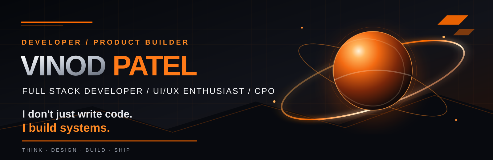

 

  

### I don't just write code. I build systems.

*Engineering thoughtful products where technology, usability, and creativity meet.*

---

## 01 / SYSTEM PROFILE

Hi, I'm **Vinod Patel** — a Full Stack Developer, UI/UX design enthusiast, and **Chief Product Officer (CPO)** with an interest in turning ideas into useful digital products.

I'm pursuing **B.E. in Computer Science & Business Systems at Maharaja Institute of Technology, Mysore (MITM)**. I enjoy working across the product journey: understanding a problem, shaping the experience, building the application, and improving it through iteration.

- **Build:** Web and mobile experiences, application workflows, and backend integrations.
- **Design:** User-focused interfaces, clean layouts, wireframes, and prototypes.
- **Explore:** IoT and embedded concepts, browser-based 3D, and workflow automation.
- **Collaborate:** Product ideas, practical engineering challenges, and meaningful digital solutions.

> **My approach:** Think from the user's perspective. Design with intention. Build with purpose.

---

## 02 / THE TECHNOLOGY UNIVERSE

### Languages · Frameworks · Tools

  

| Focus area | Technologies and interests |
|:--|:--|
| **Frontend** | HTML, CSS, JavaScript, TypeScript, React, Next.js |
| **Mobile** | Flutter, Dart |
| **Backend & data** | Node.js, Python, PostgreSQL, Supabase, REST APIs |
| **Programming** | C++, Python, JavaScript |
| **UI/UX** | Figma, wireframing, prototyping, responsive design, design systems |
| **Creative technology** | Three.js, browser-based 3D, IoT and embedded concepts |
| **Workflow** | Git, GitHub, VS Code, Vercel |

---

## 03 / UI/UX DESIGN LAB

I care about more than making an interface look attractive. A good product should feel clear, consistent, accessible, and easy to use.

  

### My interface design principles

| Principle | What it means in my work |
|:--|:--|
| **Clarity first** | Make the next action obvious and reduce unnecessary complexity. |
| **Consistent systems** | Reuse typography, spacing, colors, components, and interaction patterns. |
| **Responsive by design** | Plan layouts for mobile, tablet, and desktop instead of shrinking one screen. |
| **Useful feedback** | Give users clear states for loading, success, errors, and empty content. |
| **Design with purpose** | Connect every visual decision to usability or product goals. |

**Current design interests:** Dark interfaces, dashboard experiences, clean data visualization, micro-interactions, design systems, and 3D-inspired visual storytelling.

---

## 04 / SELECTED PROJECTS

A selection of live products and platforms listed in my existing portfolio README.

<table>
  <tr>
    <td width="50%" valign="top">
      <h3>01 · No-Due Portal</h3>
      <b>Clearance management platform</b>
      
A digital clearance workflow connecting students, faculty, library, accounts, coordinators, and administration with dues, approvals, and certificate generation.

      <a href="https://noc-portal-self.vercel.app/">↗ Explore project</a>
    </td>
    <td width="50%" valign="top">
      <h3>02 · AcadOps ERP</h3>
      <b>Institutional management system</b>
      
An ERP concept for academic and administrative workflows, including admissions, attendance, assessments, examinations, and mentorship.

      <a href="https://erp-client-9lbk.vercel.app/">↗ Explore project</a>
    </td>
  </tr>
  <tr>
    <td width="50%" valign="top">
      <h3>03 · MITM PlacePro</h3>
      <b>Placement management platform</b>
      
A recruitment workflow platform for students, placement administrators, and companies, covering drives, assessments, interviews, and placement activity.

      <a href="https://mitm-placepro.vercel.app/">↗ Explore project</a>
    </td>
    <td width="50%" valign="top">
      <h3>04 · MRF</h3>
      <b>Research management platform</b>
      
A research administration workflow covering candidate registration, supervisor allocation, reviews, progress reporting, publications, and examinations.

      <a href="https://mitm-rd.vercel.app/">↗ Explore project</a>
    </td>
  </tr>
  <tr>
    <td colspan="2" valign="top">
      <h3>05 · UdyogaMITra</h3>
      <b>Campus recruitment portal</b>
      
A campus recruitment ecosystem connecting students, companies, and administrators through recruitment workflows and matching.

      <a href="https://mit-place-pro-five.vercel.app/">↗ Explore project</a>
    </td>
  </tr>
</table>

---

## 05 / HOW I BUILD

~~~mermaid
%%{init: {'theme':'dark','themeVariables':{'primaryColor':'#211306','primaryBorderColor':'#FF6A00','primaryTextColor':'#FFFFFF','lineColor':'#FF8A00','fontFamily':'monospace'}}}%%
flowchart LR
    A([DISCOVER]) --> B[DEFINE]
    B --> C[DESIGN]
    C --> D[DEVELOP]
    D --> E[TEST]
    E --> F([SHIP])
    F --> G[LEARN]
    G --> A
~~~

<b>01 · Discover & define</b>

 
Understand the user, the problem, the constraints, and what a successful outcome should look like.

<b>02 · Design & prototype</b>

 
Map the experience, create the interface structure, establish reusable patterns, and test the flow before implementation.

<b>03 · Develop & validate</b>

 
Build the frontend and application logic, connect the data layer, test important states, and refine the experience.

<b>04 · Ship & improve</b>

 
Deploy, collect feedback, fix friction points, and keep improving the product.

---

## 06 / GITHUB ACTIVITY

 

 

### Contribution snake

  <picture>
    <source media="(prefers-color-scheme: dark)" srcset="https://raw.githubusercontent.com/Vinod1234-JPG/Vinod1234-JPG/output/github-snake-dark.svg" />
    <source media="(prefers-color-scheme: light)" srcset="https://raw.githubusercontent.com/Vinod1234-JPG/Vinod1234-JPG/output/github-snake.svg" />
    
  </picture>

---

## 07 / BEYOND THE CODE

- **Product thinking:** Connect user needs, product goals, and engineering decisions.
- **Automation:** Interested in turning repetitive data and document workflows into reliable tools.
- **IoT & embedded concepts:** Exploring how software can interact with the physical world.
- **3D on the web:** Interested in interactive and immersive browser experiences.
- **Continuous learning:** Experiment, reflect, improve, and share what works.

---

## 08 / LET'S CONNECT

### Have an idea worth building?

I'm interested in thoughtful collaboration, useful products, and challenges where design and engineering work together.

  

**THINK · DESIGN · BUILD · SHIP**

Designed with purpose by Vinod Patel · 2026

